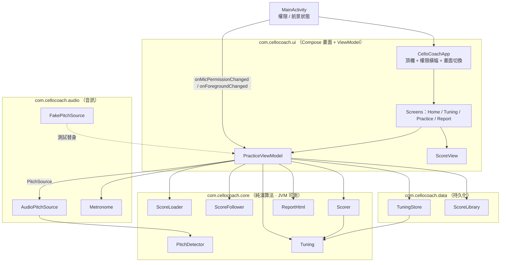
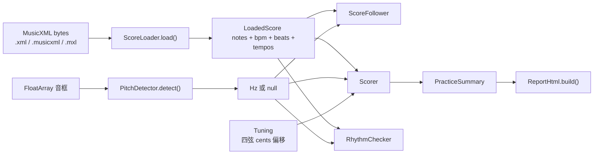
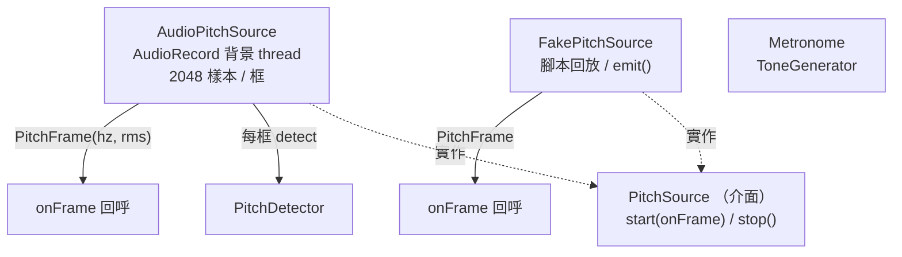
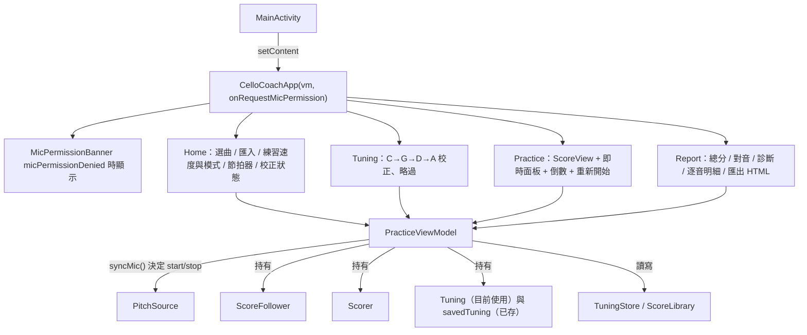

# 5. 建構區塊視圖 (Building Block View)

> arc42 第 5 章。上層：[文件索引](index.md)。相關：[4. 解決策略](04_solution_strategy.md) ｜ [6. 執行視圖](06_runtime_view.md) ｜ [8. 橫切概念](08_crosscutting_concepts.md)。

本節以靜態分解描述 CelloCoach Android App 的程式碼結構。系統把原 Python 參考實作（`music_code`：瀏覽器偵測音高 → POST 給 Flask）全部內聚到 App 內，移除了 HTTPS / secure-context / LAN 連線的痛點（背景見 [3.2](03_context_and_scope.md#32-技術脈絡與原始-web-架構對比)）。模組簽章的單一事實來源是 [CONTRACTS.md](../../CONTRACTS.md)。

## 5.1 整體分解 (Level 1)

系統依套件分層：核心演算法層（`core`）為純 Kotlin、無 Android 相依，可在 JVM 單元測試中執行；其餘各層圍繞它組裝。

### 包含的建構區塊

| 區塊 | 套件 | 職責 |
|---|---|---|
| 核心演算法 | `com.cellocoach.core` | 樂譜解析、音高偵測、跟譜、計分與診斷、調音、HTML 報告產生 — 純運算，無 Android API |
| 音訊 | `com.cellocoach.audio` | 麥克風擷取（`AudioPitchSource`）、測試假來源（`FakePitchSource`）、節拍器聲音（`Metronome`） |
| 資料持久化 | `com.cellocoach.data` | 校正結果（`TuningStore`）、匯入的樂譜（`ScoreLibrary`） |
| UI | `com.cellocoach.ui` | `CelloCoachApp` 外殼、四個畫面、`ScoreView` 五線譜、`PracticeViewModel` 狀態機、`TestTags`、主題 |
| 入口 | `com.cellocoach.MainActivity` | 取得 `RECORD_AUDIO`、回報權限與前景狀態、`setContent { CelloCoachApp(viewModel, onRequestMicPermission) }` |

## 5.2 Level 2 — core 演算法層

`core` 是系統的心臟，逐一移植自 Python 參考模組。`ScoreNote.kt` 與 `Pitch.kt`（含 `midiToHz`、`hzToMidi`、`centsBetween`、`PitchFrame`、`PitchSource`、`Clock`）為既有基礎，不重寫。

### 5.2.1 ScoreLoader

- 簽章：`object ScoreLoader { fun load(bytes: ByteArray, bpmOverride: Double? = null): LoadedScore }`
- 移植 `score_loader.py`，但**禁用 music21**；以 JDK `javax.xml`（`DocumentBuilder`）自行解析 MusicXML，關閉外部 DTD 載入。
- 自動偵測 ZIP magic bytes（`"PK"`），解壓並從 `META-INF/container.xml` 的 rootfile 取主譜 XML。
- 只取第一個 part，逐 measure 累積時間；rests 也保留在 timeline。
- tempo 優先序：`bpmOverride` > 樂譜 `<sound tempo>`／`<metronome>` > 預設 120。曲中變速建成速度表 `tempos`，音符時間依速度表換算；依 `<time>` 拍號產生拍點 `beats`（v1.0.10）。
- 解析細節與已知限制見 [8.1](08_crosscutting_concepts.md#81-樂譜解析-musicxml)。

### 5.2.2 PitchDetector

- 簽章：`class PitchDetector(sampleRate=44100, fmin=60.0, fmax=1100.0, clarityThreshold=0.9) { fun detect(samples: FloatArray): Float? }`
- McLeod Pitch Method（NSDF）：從 lag 0 計算 NSDF、跳過 lag-0 主瓣、在 `[minLag, maxLag]` 內找 key maxima，取第一個 ≥ 0.8 × 最大值者，拋物線內插求精確 lag。
- 靜音（RMS < 0.01）、clarity < 0.9、超出 `[fmin, fmax]` 回 `null`。演算法見 [8.2](08_crosscutting_concepts.md#82-音高偵測演算法)。

### 5.2.3 ScoreFollower

- 簽章：`class ScoreFollower(notes: List<ScoreNote>, clock: Clock = SystemClock, waitForCorrect: Boolean = false)`，方法 `start / started / isDone / expectedNote / currentNoteIdx / elapsed / observe`。
- 預設路徑**逐行移植** `score_follower.py`，常數 `ADVANCE_THRESHOLD_TICKS=5`、`LOOKAHEAD=3`、`TIMEOUT_FACTOR=2.5`。
- `waitForCorrect = true` 時走「等正確」路徑：停在目前音，直到該音連續正確 5 tick 才前進；沒有逾時、沒有 lookahead；休止符仍依時間前進。
- 以注入的 `Clock` 取代 `time.monotonic()`（秒 = nanos / 1e9）。前進邏輯見 [8.4](08_crosscutting_concepts.md#84-跟譜遲滯-hysteresis-與前進邏輯)。

### 5.2.4 Scorer（含診斷）

- 移植 `scorer.py` + `main.py` 的 status 判定 + 自動診斷。
- 每 tick 由 `observe(noteIdx, detectedHz)` 把樣本歸入「應在響的那顆音」，累積 `samples / voicedSamples / correctSamples / centsValues / voicedMidiCounts`。
- `summary()` 產出 `PracticeSummary`（總分、對音數、平均 cents、每顆音 `NoteSummary`、繁中診斷字串）。
- `pitchStatus()` 提供即時 GOOD/CLOSE/OFF/WRONG。計分數學與診斷規則見 [8.3](08_crosscutting_concepts.md#83-計分數學-sustain--intonation)。

### 5.2.5 Tuning

- `STRINGS`（C36 G43 D50 A57）、`Tuning` 類別含 `isCalibrated / calibrateString / offsetCentsForMidi / clear / asMap / nextUncalibrated`。
- 「note → 弦」採「最高且 nominal ≤ note 的開弦」啟發式。偏移模型見 [8.5](08_crosscutting_concepts.md#85-調音偏移模型)。

### 5.2.6 ReportHtml

- 簽章：`object ReportHtml { fun build(summary: PracticeSummary, scoreName: String, generatedAt: String): String; fun midiName(midi: Int): String }`
- 把 `PracticeSummary` 產生成**單一、自含 CSS** 的 HTML（總分卡片、診斷、逐音表格與狀態色塊），供老師離線開啟或列印。所有外部字串都經 HTML escape。

### 5.2.7 RhythmChecker（Android 新增）

- 簽章：`class RhythmChecker(notes: List<ScoreNote>) { fun observe(now: Double, currentIdx: Int, detectedMidi: Int?): RhythmEvent?; val events; fun count(issue) }`
- 每 tick 找出目前音的 onset，比較兩個 onset 的間隔與譜上間隔，判定 `RUSHING`／`DRAGGING`；前一音拉太久時不等下一音就先判 `DRAGGING`。純 Kotlin，JVM 可測。規則見 [8.4](08_crosscutting_concepts.md#84-跟譜遲滯-hysteresis-與前進邏輯)。

## 5.3 Level 2 — audio 音訊層

- `PitchSource`（定義於 `core/Pitch.kt`）是 UI 與音訊來源之間的縫合點：實機注入 `AudioPitchSource`、測試注入 `FakePitchSource`。
- `AudioPitchSource`：`AudioRecord`（MIC、44.1 kHz、16-bit mono）在背景 daemon thread 讀取，每 2048 樣本（≈ 46 ms）送 `PitchDetector.detect()` → `onFrame(PitchFrame(hz, rms))`。**可重複 `start()` / `stop()`**：每次 start 有自己的 generation，舊的擷取迴圈不會在新的啟動後繼續讀或送框；`stop()` 最多等 500 ms 讓迴圈結束。假設 `RECORD_AUDIO` 已授予（見 [8.6](08_crosscutting_concepts.md#86-錯誤與權限處理)）。
- `FakePitchSource`：同步、決定性的腳本回放或手動 `emit()`，`isRunning` 讓測試斷言麥克風是否開著。
- `Metronome`：`ToneGenerator(STREAM_MUSIC)` 的短 beep（`tick` 40 ms、`accent` 60 ms）。預設關閉；喇叭外放會被麥克風收到，建議戴耳機。

## 5.4 Level 2 — data 持久化層

| 類別 | 簽章 | 儲存位置 | 說明 |
|---|---|---|---|
| `TuningStore(dir: File)` | `load(): Tuning?`、`save(tuning)`、`savedAt(): String?` | `filesDir/tuning.json` | 不存在／壞檔／四弦不齊時 `load()` 回 `null`；只在 `isCalibrated` 時寫入，含 `a4_hz` 與 `saved_at`；無 `a4_hz` 的舊檔從 A=440 換算。手寫的小型 JSON 讀寫器，不加相依 |
| `ScoreLibrary(dir: File)` | `list()`、`exists(name)`、`read(name)`、`save(rawName, bytes): String`、`delete(name)`、`sanitize(rawName)` | `filesDir/scores/` | 匯入的樂譜。`sanitize` 只留檔名最後一段、去掉 query/fragment、非 `[\w.-]` 換成 `_`、補 `.musicxml` 副檔名，避免路徑穿越 |

同名時，匯入的曲目優先於內建 assets（`PracticeViewModel.loadScore`）。

## 5.5 Level 2 — ui 層

- **單一 Activity + Compose 狀態切換**，無 Navigation 套件：`Screen { HOME, TUNING, PRACTICE, REPORT }`，所有切換經 `PracticeViewModel.show()`，同時重算麥克風狀態。
- **`PracticeViewModel`** 是執行期協調者：持有 `ScoreFollower` + `Scorer` + `Tuning`，以 `viewModelScope` 協程跑 50 ms tick（比照 `main.py` 的 `_practice_tick_loop` 與 `_calibration_tick_loop`），以 Compose `mutableStateOf` 暴露狀態。公開 API 見 [CONTRACTS.md](../../CONTRACTS.md#ui-行為-comcellocoachui)，互動時序見 [6. 執行視圖](06_runtime_view.md)。
- **`ScoreView`**（原生 Compose Canvas，[ADR-001](09_architecture_decisions.md#adr-001-原生-compose-canvas-樂譜渲染-而非-webview--osmd)）：
  - 「提詞機」版面：五線譜與譜號固定，音符在下方水平捲動，**目前的音固定在畫面中央**；
  - 依樂譜音域自動選譜號（音高中位數 ≥ C4 用高音譜號，否則低音譜號）；
  - 依時值畫全／二分／四分／八分／十六分音符（含附點），同一拍內的八分、十六分音符以符槓相連；時值依速度表換算成 quarter，曲中變速後也不會畫錯；
  - **小節線**（v1.0.11）：照 MusicXML 的每個 `<measure>`，在每小節第一個音前畫小節線並標小節號碼，最後一音後畫終止線（細 + 粗）。位置由純 Kotlin 的 `core/ScoreLayout.barlines` 計算（音符等距排列，所以以音符索引定位）；
  - 每顆音下方標音名；目前音與音名依即時 status 上色；米色紙張底色在深色模式也清楚。
- **測試掛勾**：可測元件加 `Modifier.testTag(...)`，tag 集中於 `ui/TestTags.kt`，並開啟 `testTagsAsResourceId`，讓 `uiautomator` 與 `scripts/phone.sh` 也能用同一組 id。

## 5.6 Python 參考 → Kotlin 對應

| Python（`music_code`） | Kotlin（`com.cellocoach.*`） | 變化 |
|---|---|---|
| `score_loader.py`（music21） | `core/ScoreLoader` | 改用 `javax.xml` 自解析 |
| `pitch_detector.py`（瀏覽器結果的持有者） | `core/PitchDetector` + `audio/AudioPitchSource` | 偵測移入 App，真正做 NSDF |
| `score_follower.py` | `core/ScoreFollower` | `time.monotonic` → 注入 `Clock`；新增 `waitForCorrect` 路徑 |
| `scorer.py` + `main.py` status/診斷 | `core/Scorer` + `pitchStatus()` | 合併 |
| `tuning.py` | `core/Tuning` + `data/TuningStore` | 演算法與持久化拆分 |
| `main.py` tick loops + Flask SSE | `ui/PracticeViewModel` | SSE/HTTP 改為 in-app Compose state |
| `web/index.html`（OSMD） | `ui/ScoreView` | 原生繪製五線譜 |
| （無） | `core/ReportHtml`、`data/ScoreLibrary`、`audio/Metronome` | Android 版新增 |
