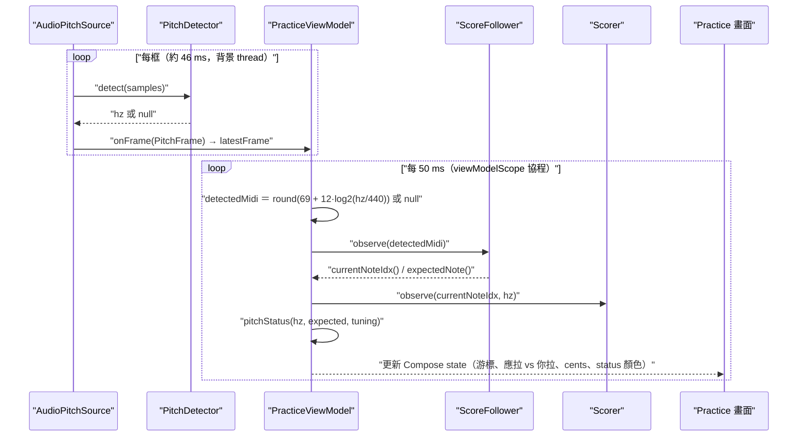
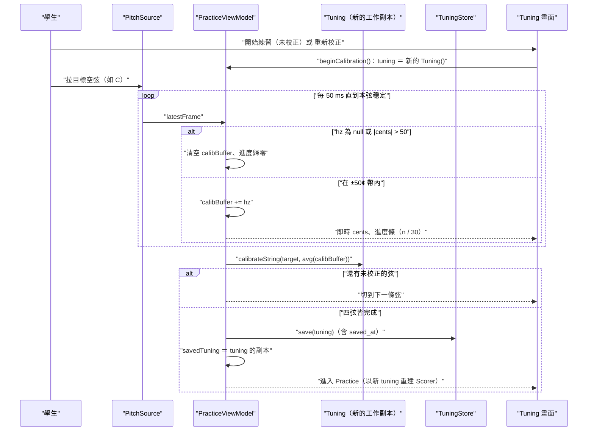
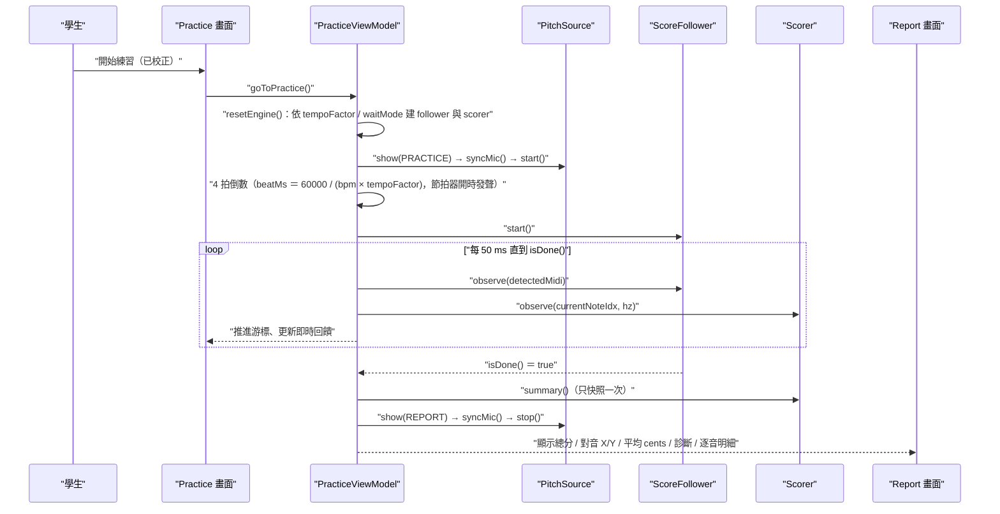
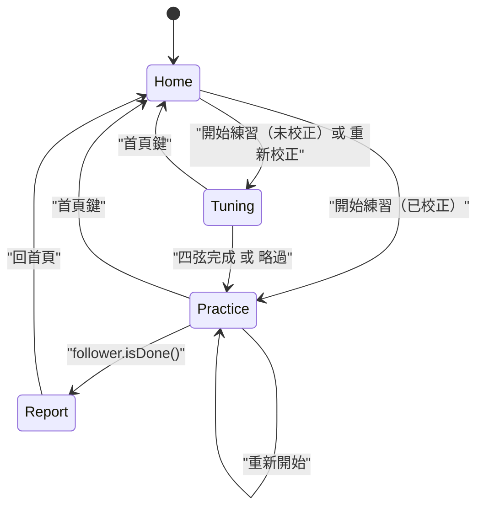
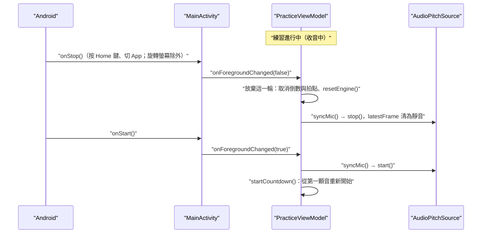
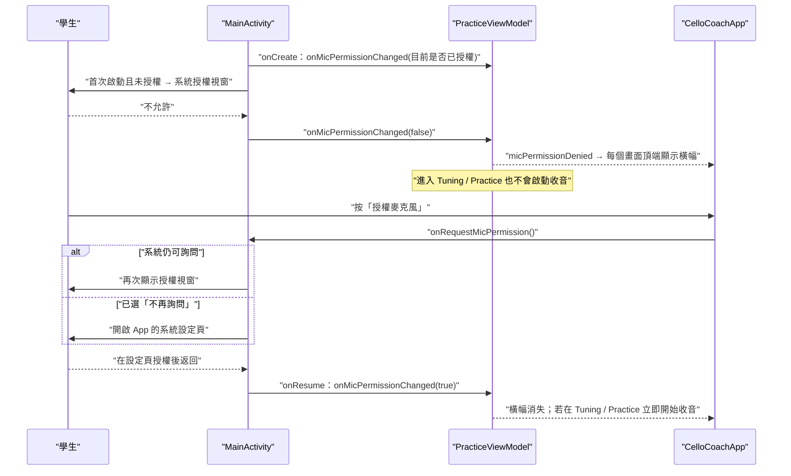
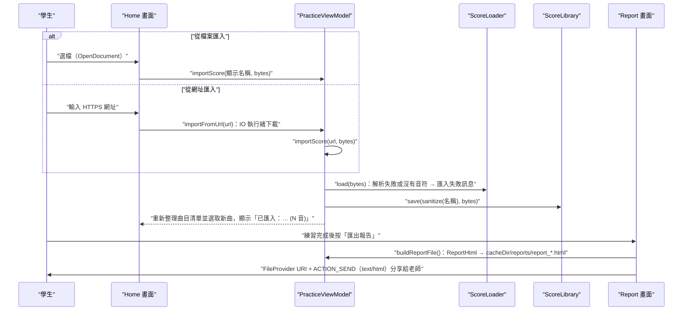

# 6. 執行視圖 (Runtime View)

> arc42 第 6 章。上層：[文件索引](index.md)。相關：[5. 建構區塊視圖](05_building_block_view.md) ｜ [8. 橫切概念](08_crosscutting_concepts.md)。

本節描述 CelloCoach 的關鍵執行期情境。練習與校正迴圈比照 Python 參考實作 `main.py` 的 `_practice_tick_loop` 與 `_calibration_tick_loop`，但把原本「瀏覽器 POST → Flask SSE」的跨程序流，內聚成 App 內 `PracticeViewModel` 對 `PitchSource` 的訂閱與 50 ms tick。

`PitchSource` 的回呼只把最新一格存進 `latestFrame`（等同原版 `detector.get()` 讀最後一次 POST 的值）；tick 迴圈每 50 ms 讀取它。

## 6.1 情境一：50 ms 練習 tick 迴圈

要點：
- 順序固定為 **先 `follower.observe` 再 `scorer.observe`**，因 Scorer 要用 follower 剛更新的 `currentNoteIdx()` 決定樣本歸到哪顆音（對齊 `_practice_tick_loop`）。
- 即使該 tick 沒偵測到音高也要呼叫 `follower.observe(null)`，讓 hard timeout 能把卡住的音推進（見 [8.4](08_crosscutting_concepts.md#84-跟譜遲滯-hysteresis-與前進邏輯)）。「等正確」模式沒有 timeout，會一直停在該音。
- ViewModel 是 follower／scorer 的唯一寫者；Compose 端只讀。

## 6.2 情境二：校正 (Calibration) 迴圈

開練前依序校正 C → G → D → A 四條空弦。每 tick 把落在目標弦 nominal ±50¢ 內的偵測值累積進 buffer，連續 `CALIB_REQUIRED_TICKS = 30` 格（約 1.5 秒）後取平均存為該弦偏移，前進下一弦；偵測為 null 或偏離 >50¢ 則清空 buffer 重來。

要點：
- 重新校正寫進一份**新的** `Tuning`；已存的 `savedTuning` 只在四弦全部完成時才被取代。
- 「略過（使用 A=440）」只讓**這一次**練習以 A=440 為基準；回首頁時 `goHome()` 會恢復 `savedTuning`。所以首頁「已校正」標示與「開始練習」的行為永遠一致（見 [8.6](08_crosscutting_concepts.md#86-錯誤與權限處理)）。
- 中途按左上「首頁」離開，同樣恢復已存校正。

## 6.3 情境三：練習 → 報告 (Practice → Report)

要點：
- 倒數畫面一定會顯示；節拍器聲音只在「節拍器」開關打開時才響，且「等正確」模式不播持續拍點。
- `summary()` 在 `isDone()` 第一次成立時快照一次（對齊 Python `last_summary`），避免報告數字在重組間漂動。
- Practice 畫面的「重新開始」呼叫 `resetPractice()`：重建 follower 與 scorer 並重新倒數（對齊 `/reset`）。

## 6.4 畫面狀態總覽

## 6.5 情境四：麥克風生命週期與背景

收音與否不是由各個按鈕各自決定，而是每次狀態改變時由 `syncMic()` 重新推導（[ADR-004](09_architecture_decisions.md#adr-004-麥克風只在需要時開啟-由狀態推導)）：

> **收音 ＝ 有 `RECORD_AUDIO` 權限 ∧ App 在前景 ∧ 畫面是 Tuning 或 Practice**

- 練習中無法「暫停」：follower 依時間判斷，背景期間的時間不可信，因此直接重來。
- 校正中切到背景只清空目前這條弦的 buffer，回來後繼續同一條弦。
- 實機驗證（Redmi 13C 5G，HyperOS 2.0）：首頁、報告頁、按 Home 鍵時系統 `dumpsys audio` 立即記錄 `rec stop`；回到 App 重新倒數且游標回到「音 1 / N」。

## 6.6 情境五：麥克風權限

## 6.7 情境六：匯入樂譜與匯出報告

