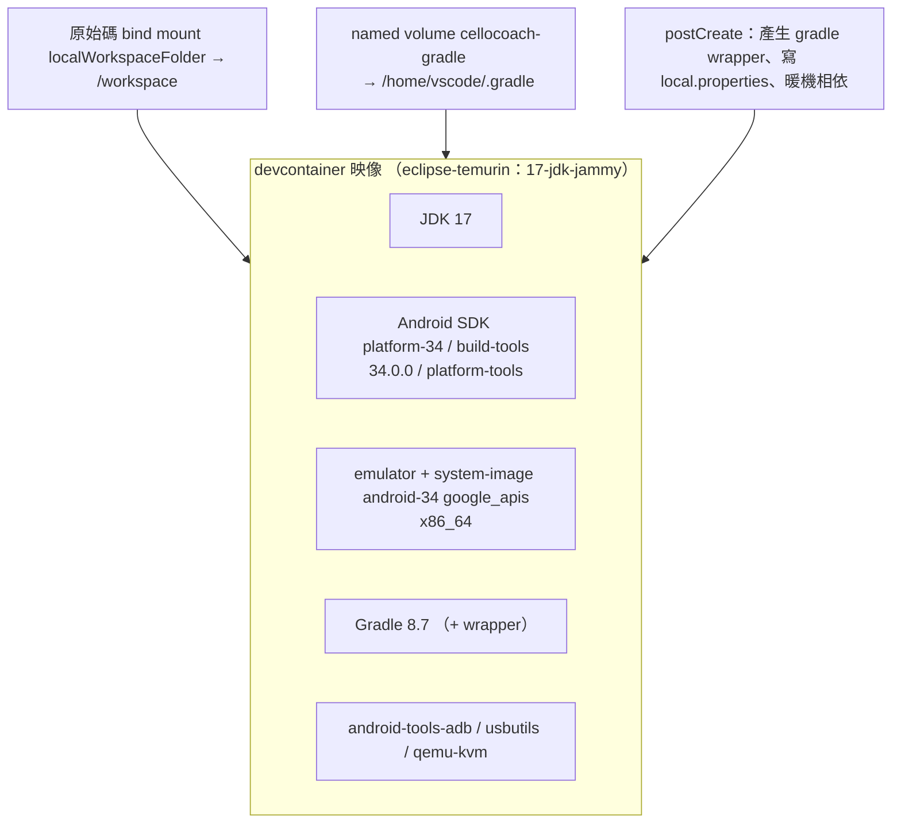
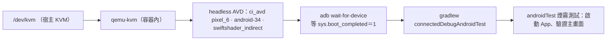
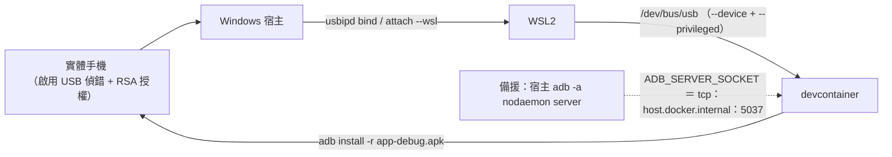
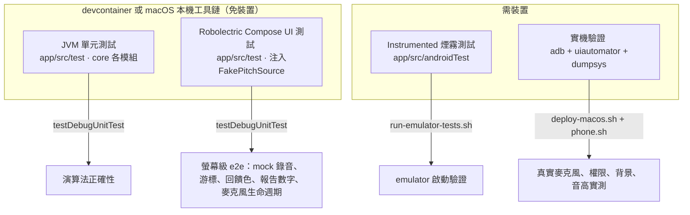
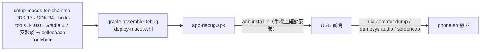

# 7. 部署視圖 (Deployment View)

> arc42 第 7 章。上層：[文件索引](index.md)。相關：[2. 架構限制](02_architecture_constraints.md) ｜ [11. 風險與技術債](11_risks_and_technical_debt.md)。

本節描述 CelloCoach 的建置、測試與部署基礎設施。主要環境是 devcontainer，它支援兩條驗證路徑：KVM 加速的 emulator 跑 instrumented E2E，以及透過 USB 部署到實體手機。沒有 Docker 的 macOS 則用本機工具鏈建置，直接部署到 USB 實機（[7.5](#75-macos-本機工具鏈--usb-實機路徑)）。

對應檔案：[.devcontainer/Dockerfile](../../.devcontainer/Dockerfile)、[.devcontainer/devcontainer.json](../../.devcontainer/devcontainer.json)、[scripts/postcreate.sh](../../scripts/postcreate.sh)、[scripts/run-emulator-tests.sh](../../scripts/run-emulator-tests.sh)、[scripts/deploy-usb.sh](../../scripts/deploy-usb.sh)、[scripts/deploy-windows-adb.sh](../../scripts/deploy-windows-adb.sh)、[scripts/setup-macos-toolchain.sh](../../scripts/setup-macos-toolchain.sh)、[scripts/deploy-macos.sh](../../scripts/deploy-macos.sh)、[scripts/phone.sh](../../scripts/phone.sh)。建構區塊見 [05](05_building_block_view.md)，測試策略對應的執行情境見 [06](06_runtime_view.md)。

## 7.1 開發容器 (devcontainer)

開發環境是一個以 `eclipse-temurin:17-jdk-jammy` 為基底的 Docker 映像，提供完整 Android 工具鏈。



| 元件 | 來源 / 設定 | 用途 |
|---|---|---|
| JDK 17 | 基底映像 | 與 `build.gradle.kts` 的 `sourceCompatibility = 17`／`jvmTarget = "17"` 對齊 |
| Android SDK | `sdkmanager` 安裝 platform-34、build-tools 34.0.0、platform-tools | 編譯（compileSdk 34、minSdk 26） |
| Emulator + system image | `system-images;android-34;google_apis;x86_64` | KVM 加速的 instrumented 測試 |
| Gradle 8.7 | 系統 Gradle 安裝；`postcreate.sh` 產生 wrapper | 建置與測試 |
| adb / usbutils / qemu-kvm | apt 安裝 | USB 部署與 KVM emulator |
| Gradle 快取 | named volume `cellocoach-gradle` → `/home/vscode/.gradle` | 跨重建持久化相依 |

容器以非 root 使用者 `vscode`、`WORKDIR /workspace` 執行。`runArgs` 帶 `--device=/dev/kvm`、`--device=/dev/bus/usb`、`--privileged`，分別支撐 emulator 加速與實機 USB。`postcreate.sh` 在建立後產生 gradle wrapper、寫 `local.properties`（`sdk.dir=${ANDROID_SDK_ROOT}`）並暖機相依。

## 7.2 KVM emulator 路徑 (instrumented E2E)

`scripts/run-emulator-tests.sh` 在容器內建立一個 headless AVD 並跑 `connectedDebugAndroidTest`。需要容器以 `--device=/dev/kvm` 啟動才有硬體加速。



啟動旗標：`-no-window -no-audio -no-boot-anim -gpu swiftshader_indirect -no-snapshot`（純 headless CI 友善）。腳本以 trap 確保 emulator PID 在退出時被清掉。

## 7.3 USB passthrough 路徑 (WSL2 + devcontainer)

在 WSL2 + Windows 宿主上，實體手機透過 `usbipd-win` 從 Windows 轉接進 WSL2，再經 `/dev/bus/usb` 進入 devcontainer，最後由 `adb` 連到手機。`scripts/deploy-usb.sh` 建置 debug APK 並安裝啟動。



宿主端前置步驟（見腳本與 [11.3 實機部署路徑 (WSL2)](11_risks_and_technical_debt.md#113-實機部署路徑-wsl2)；日常 sideload 建議改用免 usbipd 的路線 A）：

```
# Windows PowerShell（系統管理員）
usbipd list
usbipd bind   --busid <id>
usbipd attach --wsl --busid <id>
```

`deploy-usb.sh` 流程：`adb devices -l` → `adb get-state`（無裝置即報錯退出）→ `./gradlew assembleDebug` → `adb install -r app/build/outputs/apk/debug/app-debug.apk` → `adb shell monkey ... LAUNCHER` 啟動。

**備援通道**：若不做原始 USB passthrough，可在 WSL2 宿主跑 `adb -a nodaemon server`，容器靠 `ADB_SERVER_SOCKET=tcp:host.docker.internal:5037` 找到手機（devcontainer.json 已設，未用時無害）。

## 7.4 測試執行拓樸

四層驗證對應四種執行環境；前兩層在 devcontainer（或 macOS 本機工具鏈）內、免裝置：



| 測試層 | 位置 | 執行方式 | 需要裝置 |
|---|---|---|---|
| 單元（core） | `app/src/test` | `./gradlew testDebugUnitTest` | 否 |
| Robolectric Compose UI | `app/src/test` | `./gradlew testDebugUnitTest` | 否（`FakePitchSource` 餵腳本音高，`isRunning` 斷言麥克風開關） |
| Instrumented 煙霧 | `app/src/androidTest` | `run-emulator-tests.sh`（KVM emulator） | 是；在 HyperOS 實機上不可靠（見 7.5） |
| 實機驗證 | — | [`device-verify` skill](../../.claude/skills/device-verify/SKILL.md)：`deploy-macos.sh` 安裝、`phone.sh` 操作與讀狀態 | 是（USB 實機） |

## 7.5 macOS 本機工具鏈 + USB 實機路徑

沒有 Docker／devcontainer 的 macOS（Apple Silicon 或 Intel）可建立與 devcontainer 同版本的本機工具鏈，直接部署到插在 Mac 上的手機。



| 步驟 | 指令 | 說明 |
|---|---|---|
| 1. 工具鏈（一次） | `bash scripts/setup-macos-toolchain.sh --accept-android-sdk-licenses` | 約 1.4 GB；Temurin 與 Gradle 下載後驗證 checksum。旗標代表**使用者本人**同意 Android SDK 授權條款 |
| 2. 建置 + 安裝 | `bash scripts/deploy-macos.sh` | `assembleDebug` → `adb install -r` → 啟動；`WITH_TEST_APK=1` 一併安裝 androidTest APK |
| 3. 操作與觀察 | `bash scripts/phone.sh dump / tap <id> / text <id> / mic / shot <name>` | resource-id 即 `TestTags.*`（App 開啟了 `testTagsAsResourceId`） |
| 4. 音高實測 | `python3 scripts/gen-tones.py` 後用 `afplay` 播放 | 「等正確」模式讓練習畫面停在第一顆音，讀 `practice_detected` |

### 已驗證的裝置

| 裝置 | 系統 | 日期 | 結果 |
|---|---|---|---|
| Redmi 13C 5G（`23124RN87G`） | Android 15、HyperOS 2.0 | 2026-11-06 | 麥克風生命週期、背景重來、權限橫幅與設定頁、略過校正後保留已存校正、高音偵測（880 / 987.77 / 1046.5 Hz 讀值誤差 < 1¢）皆通過 |

### Xiaomi / HyperOS 的注意事項

| 現象 | 原因 | 處理 |
|---|---|---|
| `INSTALL_FAILED_USER_RESTRICTED` | 每次 USB 安裝都要在手機上按「繼續安裝」 | 請手機旁的人確認；`deploy-macos.sh` 會重試 |
| `INSTALL_FAILED_UPDATE_INCOMPATIBLE` | 手機上的版本是別台電腦的 debug keystore 簽的 | 解除安裝會清掉 App 資料；先用 `run-as com.cellocoach` 備份 `files/`，經使用者同意再解除安裝 |
| `input tap` 報 `INJECT_EVENTS` | 預設禁止 adb 模擬輸入 | 開「開發者選項 → **USB 偵錯（安全設定）**」，再執行一次 `adb usb` 讓 adbd 套用 |
| instrumentation 卡住、logcat 出現 `MIUILOG- Permission Denied Activity` | HyperOS 擋下測試程式從背景啟動 Activity | 實機改用 `phone.sh` 驗證；instrumented 測試請在 emulator 跑 |
| `connectedDebugAndroidTest` 跑完 App 不見了 | AGP 在測試結束後會解除安裝受測 APK | 實機上改用 `adb shell am instrument -w ...` |

## 7.6 約束

- 禁止新增未在 [app/build.gradle.kts](../../app/build.gradle.kts) 宣告的相依（見 [2. 架構限制](02_architecture_constraints.md)）。
- emulator 路徑強依賴宿主 `/dev/kvm`；無 KVM 時 instrumented 測試會極慢或失敗，應改走 USB 實機路徑。
- WSL2 的 USB passthrough 需 `usbipd-win` 與 `--privileged` 容器，屬已知環境脆弱點（見 [11.1](11_risks_and_technical_debt.md#111-風險)）。
- 不同機器的 debug keystore 不同；同一支手機要持續 `install -r`，就固定在同一個環境建置（devcontainer 掛 `cellocoach-android` volume；macOS 工具鏈用 `ANDROID_USER_HOME`）。
