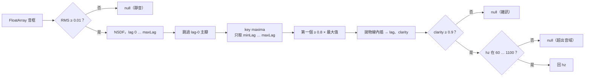
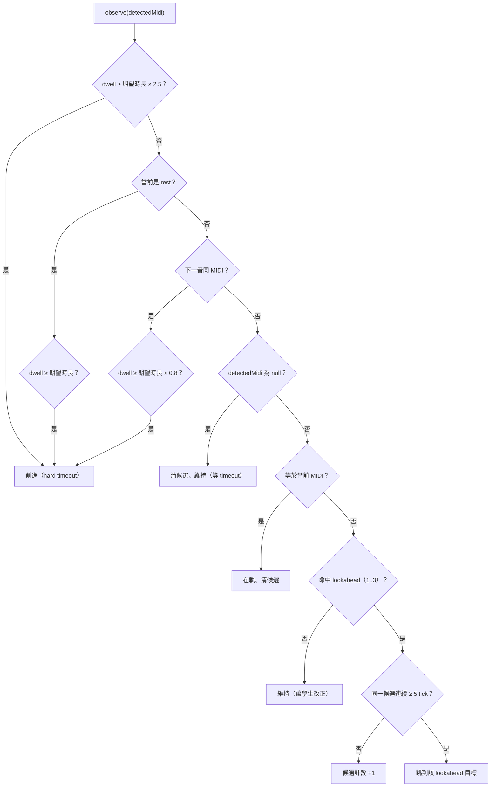

# 8. 橫切概念 (Cross-cutting Concepts)

> arc42 第 8 章。上層：[文件索引](index.md)。相關：[5. 建構區塊視圖](05_building_block_view.md) ｜ [6. 執行視圖](06_runtime_view.md)。

本節集中描述貫穿多個建構區塊的核心概念與演算法，是 [5. 建構區塊](05_building_block_view.md) 與 [6. 執行視圖](06_runtime_view.md) 反覆引用的設計依據。演算法移植自 Python 參考實作（`music_code`），並遵守 [CONTRACTS.md](../../CONTRACTS.md) 的簽章。

## 8.1 樂譜解析 (MusicXML)

`ScoreLoader` 把 MusicXML 攤平成單聲部 `ScoreNote` timeline（移植 `score_loader.py`，以 `javax.xml` 取代 music21）。

- **容器偵測**：`bytes[0]=='P' && bytes[1]=='K'` → 視為 `.mxl` ZIP，讀 `META-INF/container.xml` 的 rootfile full-path 取主譜；否則取第一個非 META-INF 的 `.xml/.musicxml`。純 XML 則直接解析。
- **離線解析**：關閉外部 DTD 載入，`EntityResolver` 一律回空內容，MusicXML 的 DTD 宣告不會觸發網路存取。
- **tempo 優先序**：`bpmOverride` > 第一個 `<sound tempo>`／`<metronome>`（beat-unit + 附點 + per-minute） > 預設 120，即開頭速度 `bpm`。
- **曲中變速**（v1.0.10）：第一個 part 內位置 > 0 的 `<sound tempo>`／`<direction>` 的 `<metronome>` 建成速度表 `tempos`；音符先以 quarter 計，最後依速度表分段換成秒（單一速度時與 Python 完全相同）。
- **小節起點**（v1.0.11）：每個 `<measure>` 的起點記成 `MeasureStart(time, number)`，練習畫面的小節線照它畫。
- **拍號與拍點**：`<attributes><time>` 決定每小節拍數與拍長（`4/beat-type` quarter，6/8 → 6 個八分拍）；每小節依實際長度產生 `Beat(time, measure, beat)`，第一小節不足一小節時視為弱起、拍號靠右對齊。沒有 `<time>` 時當作 4/4。
- **時間累積**：逐 measure，依 `<attributes><divisions>` 把 `<duration>/divisions` 換成 quarterLength。`<note>` 前進游標、`<backup>` 後退、`<forward>` 前進。
- **MIDI 換算**：`midi = (octave+1)*12 + stepSemitone[step] + alter`，`stepSemitone = C0 D2 E4 F5 G7 A9 B11`；name 用 `"$step$octave"`（有 alter 加 #/b）。
- **和弦**：含 `<chord/>` 者與前一個音同起點、取最高音、不前進游標。
- **rest**：`midi = REST(-1)`、`name="rest"`，**保留在 timeline**（與 Python 對齊）。
- 每音 `start = seconds(游標 quarter)`，`end = seconds(游標 + quarterLength)`；`seconds()` 依速度表分段累加 `60 / bpm`。

已知限制（單聲部教材沒問題，匯入的複雜樂譜可能出錯；見 [11.2](11_risks_and_technical_debt.md#112-技術債)）：

| 記譜 | 目前行為 |
|---|---|
| 同一 part 內多聲部／雙譜表（`<backup>` 後的第二聲部） | 依文件順序接在後面，timeline 不再按時間排序，跟譜會錯亂 |
| 連結線（`<tie>`） | 拆成兩顆同音分別計分（跟譜靠「重複同音 80%」處理） |
| 裝飾音（`<grace/>`，無 duration） | 變成長度 0 的音，約 0.125 秒後逾時前進 |
| 反覆記號、跳房子 | 不展開 |

## 8.2 音高偵測演算法

`PitchDetector` 是 McLeod Pitch Method（NSDF，normalized square difference function），移植自瀏覽器端 Pitchy：

1. **靜音門檻**：RMS < 0.01 直接回 `null`。
2. **NSDF**：對 lag `τ = 0 … maxLag` 計算 `n'(τ) = 2·r(τ) / m(τ)`，其中 `r(τ) = Σ x[i]·x[i+τ]`、`m(τ) = Σ (x[i]² + x[i+τ]²)`。`minLag = ⌊sampleRate / fmax⌋ = 40`、`maxLag = min(⌊sampleRate / fmin⌋, n−1) = 735`（44.1 kHz）。
3. **跳過 lag-0 主瓣**：從 lag 0 往後走到 NSDF 第一次 ≤ 0。
4. **Key maxima**：之後每個正值區段取一個最高點，只有 `[minLag, maxLag]` 內的 lag 有資格。
5. **選峰**：取第一個 ≥ 0.8 × 最大 key maximum 的峰（選最低 lag → 避免低八度誤判）。
6. **拋物線內插**：用相鄰三點求精確 lag 與 clarity；clarity < 0.9 回 `null`。
7. `hz = sampleRate / lag`；超出 `[fmin, fmax] = [60, 1100]` 回 `null`。



> **修正紀錄（2026-11）**：舊版從 `minLag` 開始掃描並跳過「那裡的正值區段」。830 Hz 以上的音，真正的音高峰所在區段剛好跨過 `minLag`，於是被當成 lag-0 主瓣跳掉，報成低八度（880 → 440 Hz）。改為從 lag 0 計算後，C2–C6 每個半音的純音與泛音豐富的合成音都在 10¢ 內；實機以喇叭播放 880 / 987.77 / 1046.5 Hz，讀值為 880.0 / 987.77 / 1046.52 Hz。回歸測試見 `PitchDetectorTest`。

下游一律用 `midi = round(69 + 12·log2(hz/A4_HZ))`，`A4_HZ = 442`（見 [8.5](#85-調音偏移模型)）。`AudioPitchSource` 每 2048 樣本（約 46 ms）送一框；ViewModel 以 50 ms tick 取用最新一框。

## 8.3 計分數學 (sustain + intonation)

`Scorer` 每 tick 把樣本歸入 follower 指定的當前音，累積三個計數與 cents 清單（移植 `scorer.py`）：

| 計數 | 意義 |
|---|---|
| `samples` | 落在該音窗內的總 tick 數 |
| `voicedSamples` | 有偵測到音高的 tick |
| `correctSamples` | 偵測 MIDI 等於期望 MIDI 的 tick |

每音指標：

- `sustain = correctSamples / samples`（∈ [0,1]）。
- `cents`：當 `playedMidi == expectedMidi` 時，`rawCents = 1200·log2(hz / expectedFreq)`，再**扣掉該弦校正偏移**（見 8.5），存的是「演奏誤差」而非「樂器走音」。
- `intonation = max(0, 1 − trimmedMean(|cents|, 0.2) / 50)`。
- `score = (0.5·intonation + 0.5·sustain) × 100`。rest 的 `score = 100`，且不累積樣本。

**Trimmed mean（截尾平均，去頭尾各 20%）**：避免起弓瞬間的不穩把 intonation 拉低。

```
sorted = sort(values); k = floor(len·0.2)
middle = (len − 2k ≥ 1) ? sorted[k : len−k] : sorted
trimmedMean = mean(middle)
```

`summary()` 彙總：`score` = 各可演奏音 score 平均；`nCorrect` 以 `sustain > 0.5` 計；`meanCents` = 全體 cents 的 trimmed mean；另含每音 `NoteSummary`（含 `modalPlayedMidi` — 該音最常被拉出的 MIDI，用來回答「拉錯時實際拉成什麼」）。

**即時 status**（`pitchStatus()`，比照 `main.py`）：先比 MIDI，不符 → `WRONG`；否則依 `|cents|`：`<20 GOOD`、`<50 CLOSE`、其餘 `OFF`。對應 UI 綠／琥珀／橘／紅。

**自動診斷**（產生繁中字串，無問題則空 list）：

| 規則 | 觸發條件 | 訊息範式 |
|---|---|---|
| 整體偏移 | `|meanCents| ≥ 10` | 「整體音準偏{高/低} {x}¢」 |
| 重複錯音 | 同一 `expectedName` 出現 ≥2 次且都 `!pitchOk` | 「{name} 反覆拉錯（{n} 次）」 |
| 系統性偏移 | 某弦上的音平均 cents 偏移 ≥ 15 | 「{C/G/D/A} 弦的音普遍偏{高/低}」 |

## 8.4 跟譜遲滯 (hysteresis) 與前進邏輯

`ScoreFollower.observe(detectedMidi)` 為**單向**前進。預設路徑逐行移植 `score_follower.py`，每 tick 依序判斷：



常數（`ADVANCE_THRESHOLD_TICKS=5`、`LOOKAHEAD=3`、`TIMEOUT_FACTOR=2.5`）的意義：

- **Hard timeout（×2.5）**：學生卡在某音太久（漏拍或偵測失敗）時強制前進，是安全網 — 因此每 tick 即使無音高也要呼叫 `observe(null)`。
- **重複同音 80%**：相鄰兩音同 MIDI 無法用音高區分，過 80% 時長即視為跨入下一音。
- **Lookahead + 遲滯**：偵測到的音命中後 1..3 顆音，且**連續 5 tick**（~250 ms）指向同一目標才跳，濾掉起弓瞬態並支援「拉快／跳音」。
- 時鐘以注入的 `Clock`（`nowNanos / 1e9` 秒）取代 `time.monotonic()`，測試可用假時鐘精準驅動。

**練習模式**（Android 版新增，[ADR-005](09_architecture_decisions.md#adr-005-練習模式-慢速與等正確-不改動移植常數)）：

| 模式 | 作法 | 效果 |
|---|---|---|
| 自選速度（♩ = `practiceBpm`，30–240） | 首頁以 − / + （±1）與滑桿設定，取整數；載入曲目時重設為樂譜原速 `bpm`。`tempoFactor = practiceBpm / bpm`，`engineNotes()` 把每顆音的 `start/end` 除以它後交給 follower 與 scorer；倒數拍長 `beatMs = 60000 / practiceBpm`（下限 120 ms） | 逾時、休止、80% 規則全部跟著所選速度縮放（可慢也可快）；五線譜顯示不變；練習畫面右上顯示「♩ = N」 |
| 節拍與速度跟著樂譜（v1.0.10） | 倒數一小節（拍號拍數；1–2 拍的拍號數兩小節）；持續拍點依 `engineBeats()`（拍點 ÷ `tempoFactor`）排程、重拍加重音；`currentBpm` = 目前音所在速度 × `tempoFactor` | 3/4、6/8、曲中變速都照樂譜；練習畫面顯示「♩ = N・拍號」與「第 m 小節・第 b 拍」 |
| 等正確（`waitForCorrect = true`） | 獨立開關，可搭配任何速度。停在目前音；**目前音**連續正確 5 tick 才前進；沒有 timeout 與 lookahead；休止依（縮放後的）時間前進；不播持續拍點 | 逐音慢練；沒拉對就一直停著 |

**節奏判定**（`core/RhythmChecker`，Android 新增，等正確模式不判定）：

| 規則 | 作法 |
|---|---|
| onset | 跟譜器目前音的音高連續出現 ≥ `ONSET_TICKS`（3）tick，onset 時間取這段音高的起點；同音反覆要中間有無聲（換弓）才算 |
| 比較間隔而非絕對時間 | 偏差 = （這次 onset − 上次 onset）−（譜上兩音 start 差，已依練習速度縮放）；起拍晚了只影響第一音，不會整首都判錯 |
| 容許誤差 | `max(MIN_TOLERANCE_SEC = 0.15 s, RELATIVE_TOLERANCE = 0.3 × 譜上間隔)` |
| 搶拍／拖拍 | 偏差 < −容許 → `RUSHING`；> 容許 → `DRAGGING` |
| 即時拖拍 | 還拉著前一音（或無聲）而下一個不同音已逾時 → 當下就判 `DRAGGING`，不必等學生拉到下一音 |
| 不重複、不誤判錯音 | 每顆音最多報一次；拉成別的音高不算節奏錯（交給音準回饋） |

警示在練習畫面以紅色橫幅顯示 1.5 秒（`RHYTHM_WARNING_HOLD_SEC`），結束時把搶拍／拖拍的音號寫進報告診斷。

## 8.5 調音偏移模型

真實大提琴鮮少恰好落在標準音高，各弦張力老化也不同步。`Tuning`（移植 `tuning.py`）讓計分以「你的琴的實際音高」為基準：

- **標準音高**：`A4_HZ = 442.0`（`ScoreNote.kt`），所有 `midiToHz` / `hzToMidi` / `log2(hz/A4_HZ)` 都以它為準。Python 原版是 440，v1.0.8 改為樂團常用的 442（[ADR-006](09_architecture_decisions.md#adr-006-標準音高改為-a442)）。
- 開弦 nominal：C36、G43、D50、A57（`STRINGS`），A3 = 221 Hz。
- `calibrateString(name, hz)`：`offset = 1200·log2(hz / nominalHz(name))`，存為該弦 cents 偏移。
- **note → 弦啟發式**（`stringForMidi`）：取 nominal ≤ 該音的**最高**開弦（低於 C2 仍歸 C）。偏向「較高弦的低把位」，符合一到四把位常態；拇指把位會誤判，MVP 可接受。
- `offsetCentsForMidi(midi)`：回該音所在弦的偏移（未校正回 0）；Scorer 與 `pitchStatus` 算 cents 時扣除它。
- `asMap()` 四捨五入到 0.1；`nextUncalibrated()` 回標準序中第一個未校正弦，驅動 [6.2](06_runtime_view.md#62-情境二校正-calibration-迴圈) 的校正流程。

持久化由 `TuningStore` 負責（`filesDir/tuning.json`，僅 `isCalibrated` 時寫、含 `a4_hz` 與 `saved_at`）；壞檔或四弦不齊則 `load()` 回 `null`。沒有 `a4_hz` 的舊檔（v1.0.8 前或 Python 版寫的）視為以 A=440 量測，載入時每弦加上 `1200·log2(440/442) ≈ −7.85¢`，同一把琴換算後與用 442 重新校正的結果相同，使用者不必重校。除此之外 JSON 仍無正式 schema 版本（技術債，見 [11.2](11_risks_and_technical_debt.md#112-技術債)）。

## 8.6 錯誤與權限處理

- **麥克風權限**：`AudioPitchSource` 假設已有 `RECORD_AUDIO`；取得權限是 UI 層責任。`MainActivity` 首次啟動時請求，並在 onCreate / onResume / 授權結果時把實際狀態回報給 `PracticeViewModel.onMicPermissionChanged`；被拒時不啟動 `PitchSource`，各畫面頂端顯示橫幅與「授權麥克風」重試（系統不再跳窗時改開 App 設定頁），不可崩潰。流程見 [6.6](06_runtime_view.md#66-情境五麥克風權限)。
- **麥克風生命週期**：`PitchSource` 只在「校正 / 練習」畫面、App 在前景且有權限時執行；首頁、報告頁與背景一律停止收音（`PracticeViewModel.syncMic`）。練習中切到背景會放棄這一輪，回到前景後從頭重新倒數。流程見 [6.5](06_runtime_view.md#65-情境四麥克風生命週期與背景)。
- **音訊不可用**：偵測連續回 null 時，follower 靠 hard timeout 仍能推進、Scorer 該音 `sustain≈0`，系統優雅降級而非卡死。
- **樂譜解析失敗**：選到無法解析的曲目時不會崩潰，但引擎仍沿用上一首的音符（畫面上的曲名已換，屬已知小問題，見 [11.2](11_risks_and_technical_debt.md#112-技術債)）；匯入時解析失敗或沒有任何音符，顯示「匯入失敗：無法解析為樂譜」且不寫入曲目庫。
- **網址下載失敗**：顯示「下載失敗：{原因}」；明文 HTTP 會被系統擋下（Android 9+ 預設）。
- **跟譜單向性**：學生回頭重拉前段不會倒回（MVP 限制，避免 beam search）；報告以實際走過的 timeline 計分。
- **校正容錯**：偵測偏離目標弦 >50¢ 或靜音時清空 buffer 重來，避免把錯弦/雜訊記成偏移。
- **已存校正不被覆蓋**：重新校正是寫進一份新的 `Tuning`，四弦全部完成才取代已存的校正；中途離開或按「略過（A=442）」只影響當次練習，回首頁即恢復已存校正，讓「已校正」標示與「開始練習」的行為一致。

## 8.7 並行模型

| 執行緒 | 做什麼 | 共享狀態 |
|---|---|---|
| 主執行緒（`viewModelScope`） | 50 ms tick、倒數、節拍器拍點、所有 Compose state 寫入 | follower / scorer / tuning 只在這裡寫 |
| `AudioPitchSource` 背景 thread | `AudioRecord.read` → `PitchDetector.detect` → `onFrame` | 只寫 `@Volatile latestFrame` |
| `Dispatchers.IO` | 「從網址匯入」的下載 | 下載完回主執行緒再寫 state |

- **單一寫者**：`PracticeViewModel` 是 follower／scorer 的唯一寫者；Compose 端只讀。
- **晚到的框**：`sourceStarted` 為 `@Volatile`，回呼只在它為 true 時寫 `latestFrame`；停止收音時把 `latestFrame` 清成靜音，避免用舊讀值計分。
- **重複啟停**：`AudioPitchSource` 每次 `start()` 遞增 generation，擷取迴圈只在自己的 generation 仍是最新時繼續與送框，所以快速 stop → start 不會留下兩個同時讀麥克風的迴圈。
- 純 `core` 模組無共享可變狀態（除 follower/scorer 實例本身），可在 JVM 單元測試中安全平行測。

## 8.8 測試性 (Testability)

- `core` 全為純 Kotlin、無 Android 相依 → JVM 單元測試直接覆蓋演算法（例如 `PitchDetectorTest` 掃過 C2–C6 每個半音）。
- **注入縫合點**：
  - `Clock`：讓 follower 的時間邏輯可決定性測試；
  - `PitchSource`：`FakePitchSource` 在 Robolectric 中重放音高腳本，`isRunning` 可斷言麥克風開關；
  - `PracticeViewModel(autoDrive = false)` + `stepForTest()`：測試逐 tick 驅動引擎（Compose 測試時鐘不會推動協程 `delay`）；
  - `onMicPermissionChanged` / `onForegroundChanged`：測試直接模擬權限與前景變化。
- 所有可測 UI 元件加 `Modifier.testTag(...)`，tag 集中於 `ui/TestTags.kt`，並以 `testTagsAsResourceId` 暴露給 `uiautomator`。
- **實機驗證**不寫成 instrumented 測試，而是用 `scripts/phone.sh`：以 resource-id 點擊、讀文字、截圖，並以 `dumpsys audio` 的收音事件（`rec start / stop`）判斷麥克風狀態。步驟見 [`device-verify` skill](../../.claude/skills/device-verify/SKILL.md)。

## 8.9 匯入、匯出與檔案安全

| 面向 | 作法 |
|---|---|
| 匯入驗證 | 先用 `ScoreLoader.load` 解析；失敗或沒有音符就不寫入 |
| 檔名 | `ScoreLibrary.sanitize`：只取最後一段路徑、去掉 `?query` / `#fragment`、非 `[\w.-]` 換成 `_`、沒有可辨識副檔名就補 `.musicxml`，避免路徑穿越 |
| 同名 | 匯入的曲目優先於內建 assets |
| 匯出位置 | `cacheDir/reports/report_<曲名>.html`；`FileProvider` 只開放 `cache-path reports/`，並以 `FLAG_GRANT_READ_URI_PERMISSION` 授權給接收的 App |
| HTML 內容 | 所有外部字串（曲名、音名、診斷）經 `&`、`<`、`>`、`"` escape；CSS 內嵌，不載入外部資源 |
| 尚未處理 | 下載沒有大小上限；XML 未開啟 secure-processing（極端的 entity 展開檔可能耗盡記憶體）。見 [11.1](11_risks_and_technical_debt.md#111-風險) |
